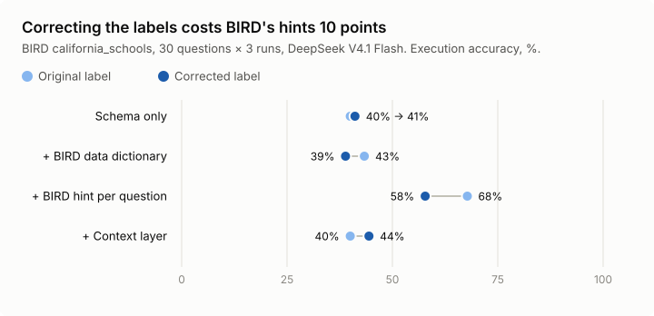

# Text-to-SQL with and without a context layer

I wanted to know how much a context layer helps a text-to-SQL agent. A context layer is a file that a data team
writes once to explain what the tables mean, how they join and how metrics are computed. I gave one agent the 30
questions on BIRD Mini-Dev's `california_schools` database with four kinds of context, and graded every answer
twice: against the labels before and after Jin et al.'s [audit of BIRD](https://arxiv.org/abs/2601.08778), which
found errors in 52.8% of Mini-Dev. The model is DeepSeek V4.1 Flash, run three times per question.

## Results

<picture>
  <source media="(prefers-color-scheme: dark)" srcset="docs/accuracy-dark.svg">
  
</picture>

Grading the same answers against the corrected labels moves the arms in opposite directions. The agent with BIRD's
hints loses 10 points, because the hints were written for the original queries and following them reproduces those
queries, mistakes included: on the 9 questions where the two labels disagree, its answers matched the original label
14 times and the corrected one 5 times. The agent with the context layer gains 4 points and finishes 3 points ahead
of the schema alone, but 30 questions can't tell that lead from noise (its 95% interval runs from -9 to +17).

The layer changed the agent's SQL far more than its score. Every context-arm answer that used the SAT table dropped
its district totals, as the audit's corrections do, against 8 to 19% of answers in the other arms. Yet on the ten
questions where the audit added that filter, the context arm beat the schema arm on only one. The rest turned on
other details, such as how many of a school's three administrator slots to return, or whether every school tied for
the lowest rate counts.

## Setup

Every arm gets the table definitions and a `run_sql` tool for exploring the data. The `schema` arm gets nothing
else. The `dictionary` arm adds the data dictionary that BIRD ships with the database. The `hints` arm adds BIRD's
hint for each question, which no real user would supply. The `context` arm adds
[a context layer](context/california_schools.yaml) that I wrote by profiling the database. It is shorter than BIRD's
dictionary and corrects several things the dictionary gets wrong: it calls the `rtype` column that separates schools
from district totals "unuseful", it says K-12 enrollment starts at first grade, and its excellence-rate formula
truncates to zero for most schools under SQLite's integer division.

The original labels are the ones the audit started from. The corrected labels come from the audit's SQL-only
release, which changes the reference queries but not the questions, so the same answer can be graded against both.
On this database they give different answers to 9 of the 30 questions. Scoring is BIRD's execution accuracy with
floats rounded to 10 significant digits, because BIRD's strict version marks 0.904907975460123 wrong against
0.9049079754601227. Strict scores are in each run's `summary.md`.

## Limitations

Thirty questions on one database is a small sample. The context layer isn't blind: I wrote it after reading the paper
and seeing some of these questions, although everything in it comes from the data or the state's file documentation
rather than from the questions. I changed it once, before either run, to fix a false claim about the percentage
columns. The first run, in `results/20261110_102042_spike`, gave up on agents still exploring after eight steps,
which left 12 to 20% of each arm unanswered and put the context layer 3 to 4 points behind the schema alone. The
second gives them one last call to submit. The hints lost 10 points to the corrected labels in both.

## Run it

A full run makes about 1,700 model calls and costs about $0.80 on OpenRouter.

```bash
pip install -r requirements.txt
cp .env.example .env    # add OPENROUTER_API_KEY
python -m bench.fetch_data
python -m bench.run --repeats 3 --label main
python -m bench.report results/<run_dir>
python -m bench.plot results/<run_dir>
```
