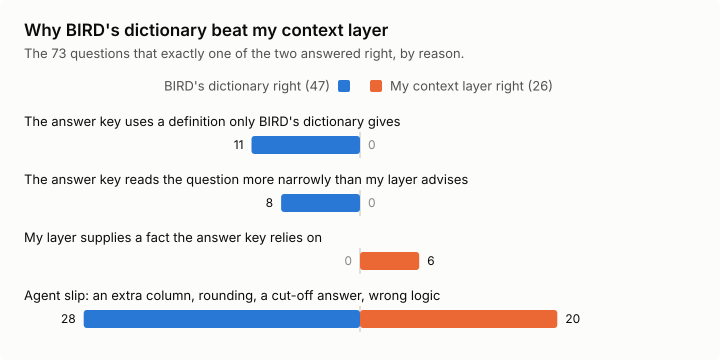

# Text-to-SQL with and without a context layer

I wanted to know whether a context layer makes an AI agent better at answering questions about a database by
writing SQL. A context layer is a file a data team writes once to explain what the tables mean, how they join, what
the codes stand for and where the data misleads. I made one for each of the 11 databases in BIRD Mini-Dev, a public
text-to-SQL benchmark, and had the same agent answer its 496 questions three ways: with no extra help, with the data
dictionary that BIRD ships, and with my context layer. Every answer is graded against the corrected answer key from
Jin et al.'s [2026 audit of BIRD](https://arxiv.org/abs/2601.08778).

## Results

My context layer made no measurable difference, and BIRD's own dictionary did better than it.

| Extra help | Questions answered right |
|---|---|
| None | 62% |
| BIRD's data dictionary | 69% |
| My context layer | 65% |

The layer's 3-point lead over no help is within what chance could produce (the 95% interval runs from -0.4 to +7.1
points). The dictionary's 7.5-point lead is not, and it beat the layer by 4.

That surprised me, because the layer corrects more than a dozen mistakes in the dictionary. Comparing the two
question by question shows why. They disagreed on 73 questions:

<picture>
  <source media="(prefers-color-scheme: dark)" srcset="docs/disagreements-dark.svg">
  
</picture>

Slips, such as returning an extra column, happen to both. What tips the balance is the answer key. On 11 questions
it relies on a definition that only BIRD's dictionary gives, and on 8 more it reads the question more narrowly than
my layer advised. The layer won 6 by supplying a fact the key also uses.

Some of those definitions are wrong about the data. On the fuel-card database the dictionary says a transaction's
price is per unit, but dividing it by the quantity gives a steady 23 crowns a litre for diesel, so it is the total,
as my layer says. The key follows the dictionary, so the agent that believed the data was marked wrong. The audit
even rewrote that question's reference query and kept the per-unit reading. On the statistics Q&A site, a
"well-finished" post is, by the dictionary's definition, one with a closed date, which on Stack Exchange means the
question was shut down. So part of the dictionary's lead is not better documentation but agreement with the answer
key, including where both are wrong.

## The data

BIRD Mini-Dev has 500 questions over 11 SQLite databases, most of them built from public datasets: California
schools, a Czech bank, a Czech fuel-card company, Formula 1 since 1950, European football, Magic: The Gathering
cards, the Cross Validated statistics Q&A site, a hospital's lab tests, molecules tested for cancer risk,
superheroes and a student club. Each question comes with a reference SQL query, and the right answer is whatever
that query returns. Each database also ships with a data dictionary, one CSV per table describing its columns. The
audit kept BIRD's questions and rewrote the reference queries it judged wrong. I grade against its version and
leave out 2 of its 498 questions, whose reference query runs longer than 30 seconds.

`bench/fetch_data.py` pulls only the databases, dictionaries and question file out of BIRD's 800 MB zip, takes the
audit's answer key from its GitHub repository at a fixed commit, and checks every file against a pinned checksum, so
each run sees the same bytes. The agent, DeepSeek V4.1 Flash, sees the table definitions plus whichever extra help
its version gets, and works through a read-only connection: it can only read, each query stops after 30 seconds,
and it sees at most 30 rows of any result. It has up to nine model calls to explore the data and submit one query.
The grader runs that query again and counts it right when it returns the same set of rows as the reference, with
decimals compared to 10 significant digits. Every model call, answer and conversation is saved under `results/`,
and a spend cap stops the run if it goes over budget.

## How the context layers were made

I drafted the layers with an AI coding assistant that could query each database. For every table it counted rows,
listed the values in code columns, measured how often each column is empty and checked that the joins match. Then
it checked BIRD's dictionary against the data and wrote down what holds and where the data misleads:
Formula 1's standings hold running season totals, not points per race, and footballers' weights are in pounds. A
few meanings come from the original datasets' public documentation instead, such as the Czech bank's district
columns. Each layer is 700 to 1,800 tokens long and is in [context/](context/). They were committed before anyone
read the questions (commit 4c05389), except for california_schools, the pilot database.

What profiling cannot supply is the benchmark's own definitions, such as "popular" meaning most viewed, and where
those definitions contradict the data, the layers side with the data. Those are the 11 questions above.

## Limitations

This is one run of one cheap model on one benchmark. The per-database results in each run's `summary.md` rest on 30
to 66 questions each, too few to say where the layer helps most. I made the layers and also sorted the 73
disagreements, so the sorting is in [docs/context_vs_dictionary.csv](docs/context_vs_dictionary.csv) for anyone to
check. The assistant that drafted the layers may have seen BIRD during its training. Leaving out california_schools
moves each comparison by less than a point. `results/` also holds the pilot runs on california_schools alone.

## Run it

A full run makes about 6,100 model calls and costs about $2 on OpenRouter.

```bash
pip install -r requirements.txt
cp .env.example .env    # add OPENROUTER_API_KEY
python -m bench.fetch_data
python -m bench.run --label main
python -m bench.report results/<run_dir>
python -m bench.plot results/<run_dir>
```
